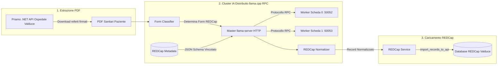

# SenoNetwork - Pipeline Referti Medici: .NET API ➡️ IA Locale (llama.cpp RPC) ➡️ REDCap

Soluzione software completa per la gestione automatizzata dei referti medici senologici:
1. **Estrazione PDF da API .NET** (cartelle cliniche, mammografie, ecografie, biopsie, istologici tramite Priamo HIS Valduce).
2. **Elaborazione con IA Locale su llama.cpp (Distribuita su 2 schede con protocollo RPC)**:
   - Inferenza ad alte prestazioni ripartita su 2 GPU/schede tramite `rpc-server`.
   - Vincolo grammaticale GBNF / JSON Schema conforme alle specifiche del Data Dictionary REDCap.
   - Classificazione automatica del form REDCap per ogni tipologia di referto.
3. **Caricamento Diretto su REDCap** (aggiornamento dei record del paziente nel database [REDCap Valduce](https://redcap.valduce.it/redcap/)).

L'inferenza viene eseguita interamente in locale sui server ospedalieri, garantendo la **totale conformità al GDPR e la privacy assoluta dei dati sanitari (zero cloud leak)**.

---

## 🏗️ Flusso della Pipeline Paziente



---

## 🖥️ Configurazione del Cluster llama.cpp con RPC (2 Schede GPU)

llama.cpp supporta nativamente l'inferenza distribuita tramite il backend RPC (`rpc-server`):

### 1. Architettura di esecuzione
- **Scheda 0**: esegue `rpc-server` in ascolto su porta `50052`
- **Scheda 1**: esegue `rpc-server` in ascolto su porta `50053`
- **Master Server**: esegue `llama-server` ripartendo i tensori del modello tra le due schede:
  ```bash
  llama-server \
    -m /percorso/al/modello.gguf \
    --rpc 127.0.0.1:50052,127.0.0.1:50053 \
    --host 0.0.0.0 --port 8080 \
    -c 8192 --n-gpu-layers 999
  ```

### 2. Verifica configurazione e server
Assicurati di aver configurato il tuo file `.env` locale a partire dal template [`.env.example`](.env.example).

---

## ⚙️ Configurazione nel file `.env`

```env
# ==============================================================================
# REDCap API
# ==============================================================================
REDCAP_API_URL=https://redcap.valduce.it/redcap/api/
REDCAP_API_TOKEN=TUO_TOKEN_API_REDCAP

# ==============================================================================
# IA Locale: llama.cpp con Inferenza Distribuita RPC (Master Server)
# ==============================================================================
AI_BACKEND=llama_cpp
LLAMA_CPP_BASE_URL=http://localhost:8080
LLAMA_CPP_API_MODE=chat
LLAMA_CPP_TEMPERATURE=0.0
LLAMA_CPP_TIMEOUT_SECONDS=180

# Fallback opzionale Ollama
OLLAMA_BASE_URL=http://localhost:11434
OLLAMA_MODEL=llama3.2:3b

# ==============================================================================
# Priamo .NET API (Ospedale Valduce)
# ==============================================================================
CLOUDFLARED_CLIENT_ID=TUO_CLOUDFLARE_CLIENT_ID.access
CLOUDFLARED_CLIENT_SECRET=TUO_CLOUDFLARE_CLIENT_SECRET
PRIAMO_API_URL=https://priamo-home.valduce.it:8062
PRIAMO_USERNAME=TUO_USERNAME
PRIAMO_PASSWORD=TUA_PASSWORD
```

---

## 🚀 Modalità di Utilizzo

### Modalità A: Singolo Paziente da Priamo ➡️ llama.cpp (RPC) ➡️ REDCap
```bash
.venv/bin/python main.py \
  --name "NomePaziente" \
  --surname "CognomePaziente" \
  --dob "1965-10-22" \
  --backend llama_cpp \
  --import-to-redcap
```

### Modalità B: Batch su Coorte Excel (`interventi.xls`)
```bash
.venv/bin/python main.py \
  --excel /path/to/interventi.xls \
  --limit 5 \
  --backend llama_cpp \
  --import-to-redcap
```

### Modalità C: Microservizio HTTP REST (Integrazione Diretta con .NET)
```bash
.venv/bin/python main.py --serve --port 8000
```

---

## 🧪 Esecuzione Test Unitari
```bash
uv run pytest tests/ -v
```
